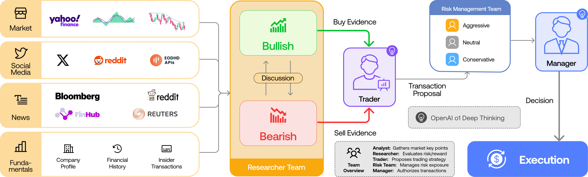

<a name="readme-top"></a>

<div align="center">

# TradingAgents Korea 🇰🇷

**ただ分析して終わりではありません。記憶し、自らを採点し、間違いを減らしていきます。**

過去の判断を記録し、それを hit/miss で採点して次の判断を修正していく韓国株リサーチエージェントです。KIS・DART・ECOS・Naver News の実データの上でマルチエージェントが議論し、お使いの Claude Code / Codex サブスクリプション CLI 上で動作します。

[](#-核心となる仕組みaiリサーチ自己改善ループ)
[](https://github.com/malda231125/TradingAgents-KR/actions/workflows/ci.yml)
[](LICENSE)
[](pyproject.toml)
[](https://github.com/TauricResearch/TradingAgents)
[](#なぜ-tradingagents-korea-なのか)

[English](README.md) · [한국어](README.ko.md) · [日本語](README.ja.md) · [中文](README.zh.md)

[クイックスタート](#クイックスタート) · [API キー](#api-キー) · [アーキテクチャ](#アーキテクチャ) · [サンプルレポート](examples/reports/ja/samsung-005930-2026-06-30.md)

</div>

---

> [!CAUTION]
> TradingAgents Korea はオープンソースの研究・教育プロジェクトです。投資助言でも、売買の推奨システムでも、自動売買システムでもありません。すべての投資判断とその責任は利用者に帰属します。

## このプロジェクトについて

TradingAgents Korea は [`TauricResearch/TradingAgents`](https://github.com/TauricResearch/TradingAgents) を韓国市場向けに適応させたものです。

オリジナルの TradingAgents プロジェクトは、マルチエージェント型の金融リサーチワークフローを提示しました。この fork は、そのアイデアをローカルなデータソース、韓国企業の識別子、そしてレポート重視の出力と組み合わせることで、韓国株式市場に接続します。

- **KIS**: 韓国株の価格、OHLCV、各種指標、構造化された市場データ
- **DART**: 開示情報、企業識別子、イベント文脈
- **ECOS**: 韓国銀行（中央銀行）のマクロ経済的文脈
- **Naver News**: 韓国語の国内ニュース
- **yfinance**: 補助的なグローバル/外部視点
- **Claude Code / Codex CLI**: ローカルのサブスクリプション/ログインベースで LLM を実行する経路
- **Notion export**: 生成したレポートを公開するための任意の補助フロー

```text
"Analyze Samsung Electronics"
       ↓
005930 / DART corp code / Naver query / yfinance symbol resolution
       ↓
KIS + DART + ECOS + Naver News data prefetch
       ↓
Market / news / fundamentals / macro feature packets
       ↓
TradingAgents multi-agent debate and risk review
       ↓
Markdown / Notion research report
```

> ⏱️ **レポート 1 本の生成には平均で 15 分以上かかることがあります**（GPT-5.5 または Claude Opus 4.8 を最大推論で使用した場合）。これは想定どおりの挙動です。短い要約ツールではなく、深いリサーチを行うフレームワークだからです。**実行が長く続いても、それは何かが壊れていることを意味しません。**

## ❓ なぜ ChatGPT に「サムスン電子どう？」と訊くだけではいけないのか

AI による株式分析でいちばん残念なのは、**それらしいレポートを 1 枚書いて、そこで終わってしまうこと**です。

今日は「サムスン電子は良さそうだ」と分析しても、翌日にはその判断を覚えてすらいません。当たったのか外れたのか誰も採点せず、次の分析はまた白紙から始まります。

だからこそ、これを作りました。**TradingAgents Korea の核心は、その場限りの AI 銘柄分析ではありません。**

> **毎日分析する → 予測を記録する → 翌日に検証する → 外れたら振り返る → 次の分析にフィードバックする**

この **AI リサーチ自己改善ループ**こそが要点です。

| ただ AI に訊くだけ | TradingAgents Korea |
|---|---|
| 毎回白紙から始まり、過去の判断を記憶しない | 各判断を記録し、次の実行時に**振り返る** |
| 誰も採点しない | **hit / miss / partial** で自らを採点する |
| 当たり障りのない 1 つの答え（「リスクがあるので慎重に」） | 市場・ニュース・ファンダメンタルズ・強気/弱気・リスクの**マルチエージェント議論** |
| もっともらしい架空の数値（ハルシネーション） | **feature packet** で根拠データを先に固定する |

## 🔄 核心となる仕組み：AIリサーチ自己改善ループ

ほとんどの AI 分析ツールは「分析 → レポート」で止まります。TradingAgents Korea は、その先のループを閉じます。

```text
毎日分析
   ↓
予測を記録        decisions/YYYY-MM-DD/<ticker>.json      ← 構造化された判断レコード
   ↓
翌日に検証        以前の thesis を証拠パケットと突き合わせる
   ↓
外れたら振り返る   retrospectives/YYYY-MM-DD/<ticker>.md   → hit / miss / partial / uncertain
   ↓
次へフィードバック lessons/<ticker>.jsonl                  → 次回実行のプロンプトへ注入
```

対話型 CLI は、このループを**自動で**回します。実行のたびに、その銘柄の直近の判断レコードを探し、振り返りを実行し、その教訓を次の分析へ注入したうえで、新しい判断レコードを保存します（初回実行では振り返りはスキップされます）。

```bash
# 自己改善ループを単体で実行する
.venv/bin/python scripts/run_self_loop.py --ticker 005930 --date YYYY-MM-DD
```

振り返りの判定（`hit` / `miss` / `partial` / `uncertain`）は、デフォルトでは決定論的な証拠パケットをサブスクリプション CLI の LLM がレビューして下します。決定論的なフォールバックのみで実行したい場合は `--no-ai-review` を使用してください。長時間のバッチ実行では、蓄積された教訓がプロンプトを溢れさせないように、コンパクトな `lessons/<ticker>.summary.md` と直近の教訓のみをコンテキストとして使用します。

> 私たちはリターンを誇示しません。その代わりに、**AI が自らの過去の判断を採点した記録を公開します。**

## なぜ TradingAgents Korea なのか?

米国株・グローバル株向けの AI 金融エージェントは数多くありますが、韓国株のリサーチはデータと解釈のスタックが異なります。

| 課題 | TradingAgents Korea のアプローチ |
|---|---|
| 韓国株は `005930`、`삼성전자`、`005930.KS` のように参照され得る | 解決したうえで、ソースごとの識別子を別々に保持する |
| Yahoo Finance だけでは韓国市場のデータとして不十分なことがある | 構造化された韓国市場データの層として KIS を使用する |
| 韓国の開示情報は DART を通して読むべきである | DART の開示/イベント文脈を独立した層として保持する |
| 韓国のマクロ文脈は BOK/ECOS データに依存する | ECOS ベースの金利・為替・マクロ文脈を追加する |
| LLM はもっともらしい数値を作り出すことがある | 推論の前に明示的な feature packet を構築する |
| プレミアムなマルチエージェントレポートは従量課金の LLM API では高額になりうる | 重いレポート生成を Claude Code / Codex CLI のサブスクリプションランタイムで実行する |
| 国内投資家は韓国語レポートを必要とし、グローバルな開発者は多言語ドキュメントを必要とする | 英語・韓国語・中国語の README ドキュメントと、韓国語レポート出力をサポート |

## ハイライト

- 🇰🇷 **韓国株ファースト** — `005930`、`000660`、`삼성전자`、`SK하이닉스` といった入力に対応
- 🧩 **マルチエージェント・リサーチワークフロー** — 市場、ニュース、ファンダメンタルズ、強気/弱気、トレーダー、リスク、ポートフォリオマネージャーの各ロール
- 📡 **韓国データスタック** — KIS、DART、ECOS、Naver News をファーストクラスのソースとして扱う
- 🧠 **CLI ファーストの LLM 実行** — すべてのエージェントステップを従量課金 API に流さず、Claude Code / Codex CLI 上で長時間ワークフローを実行
- 🧾 **プレミアムなレポート重視の出力** — 長文の Markdown リサーチレポートを生成し、韓国語レポート出力をサポート
- 🗂️ **Notion export ヘルパー** — OpenClaw ベースの任意の発行フロー
- 🛡️ **公開リリース向けの安全ドキュメント** — API キー、`.env`、Notion トークン、ローカルパスの漏洩を避けるためのチェックリスト

## なぜ CLI ファーストなのか?

プレミアムなマルチエージェント・リサーチはトークン消費が大きいものです。

TradingAgents Korea の 1 回の完全な実行には、市場分析、ニュース分析、ファンダメンタルズ、強気/弱気の議論、トレーディングプラン、リスク検討、ポートフォリオ判断、そして長文の Markdown レポートが含まれ得ます。このワークフロー全体を従量課金の LLM API で回すと、コストはすぐに大きくなりかねません。

TradingAgents Korea は Claude Code と Codex CLI のランタイムを中心に設計されているため、重い推論経路では、すべてのエージェントステップに対してトークン単位の API 課金を必要とせず、ユーザーが既に持つローカル CLI のサブスクリプション/ログイン環境を利用できます。

これは KIS、Naver、DART、ECOS といったデータ認証情報の必要性をなくすものではありません。また、各 CLI プロバイダーのサブスクリプション規約と利用上限の対象であることも変わりません。要点は実用的なものです。すなわち、深くプレミアムなリサーチレポートを、個人が繰り返し使えるように現実的なものにすることです。

## ポジショニング

このリポジトリは、単なるデータコネクタや MCP ツールサーバーではありません。

これは **韓国株のためのマルチエージェント・リサーチフレームワーク**として意図されています。

- FinanceDataReader のようなデータライブラリは、有用な構成要素です。
- MCP サーバーは、Claude/Cursor にツールを公開するのに有用です。
- TradingAgents Korea は、リサーチプロセス全体（データの事前取得 → アナリストの各ロール → 議論 → リスク検討 → 最終レポート）をオーケストレーションすることを目指します。

要するに:

> 短い API 従量課金のデモではなく、Claude Code と Codex CLI に最適化されたプレミアムな韓国株リサーチ。

## クイックスタート

インストールコマンドを覚える必要はありません。

開発者でない方は、Claude Code や Codex にセットアップを任せられます。

リポジトリをクローンします:

```bash
git clone https://github.com/malda231125/TradingAgents-KR.git
cd TradingAgents-KR
```

そして Claude Code または Codex にこう依頼します:

```text
Read llm.txt and install this project on my machine. Set up the Python virtual environment, install dependencies, create .env, and verify that it runs.
```

詳しいセットアップ手順は [llm.txt](llm.txt) にあります。これは AI エージェント向けに書かれており、Python のバージョン、仮想環境、依存関係のインストール、環境変数、検証ステップを含みます。

インストール後は、欲しいレポートを依頼してください:

```text
Analyze Samsung Electronics Korean stock.
Analyze 005930.
Generate a Korean equity research report for SK hynix.
```

TradingAgents Korea は短い日次サマリーツールではありません。プレミアムな長文リサーチレポートのために作られているため、銘柄やデータの可用性によっては完全な実行に時間がかかることがあります。

### 手動インストール（エージェントなし）

Claude Code / Codex を使わない場合は、自分でインストールできます。

**macOS / Linux / WSL**

```bash
git clone https://github.com/malda231125/TradingAgents-KR.git
cd TradingAgents-KR
python3 -m venv .venv
.venv/bin/python -m pip install --upgrade pip
.venv/bin/python -m pip install -e .
cp .env.example .env          # その後 .env を編集して API キーを追加
.venv/bin/python main.py 005930
```

**Windows (PowerShell)**

```powershell
git clone https://github.com/malda231125/TradingAgents-KR.git
cd TradingAgents-KR
py -m venv .venv
.venv\Scripts\python -m pip install --upgrade pip
.venv\Scripts\python -m pip install -e .
copy .env.example .env         # その後 .env を編集して API キーを追加
.venv\Scripts\python main.py 005930
```

> Debian/Ubuntu で `python3 -m venv` が `ensurepip is not available` で失敗する場合は、
> `sudo apt install -y python3-venv` を実行して再試行してください。

デフォルトの LLM ランタイムは Codex CLI です。Claude Code を使う場合は `.env` のランタイムブロックを切り替えます:

```bash
TRADINGAGENTS_LLM_PROVIDER=claude-cli
TRADINGAGENTS_QUICK_MODEL=sonnet
TRADINGAGENTS_DEEP_MODEL=opus
```

インストール後、プリフライトチェックを実行します:

```bash
.venv/bin/tradingagents doctor
```

このコマンドは実際の API キーの値を出力しません。確認するのは以下だけです:

- `codex` または `claude` CLI がインストールされているか
- 推奨される KIS / Naver / DART / ECOS キーが `.env` に入力されているか
- 不足している項目について README と発行リンクの場所を案内

どちらの CLI もインストールされていない場合は、いずれかのランタイムをインストールしてログインします:

```bash
npm install -g @openai/codex
codex login
```

```bash
npm install -g @anthropic-ai/claude-code
claude
```

CLI のインストールには Node.js/npm が必要です。アカウントのログインは対話式でユーザー本人のものです。パスワードやトークンをチャットに貼り付けないでください。

## 必要なもの

インストールは Claude Code や Codex に任せましょう。主に準備が必要なのは以下です:

- **Claude Code または Codex CLI**: 認証済みのサブスクリプションベース CLI ランタイム
- **KIS API キー**: 韓国株の価格、OHLCV、指標、ファンダメンタルズ、市場データ
- **Naver Developers キー**: 韓国の国内ニュース検索
- **DART API キー**: 開示情報、企業識別子、イベント文脈
- **ECOS API キー**: 韓国銀行のマクロデータ

キーは一度だけ `.env` に入れます。発行用リンクは [API キー](#api-キー)セクションに記載しています。

あわせて参照:

- [AI エージェント向けインストールガイド](llm.txt)
- [`.env.example`](.env.example)
- [設定ガイド](docs/configuration.md)
- [API キーガイド](docs/api-keys.md)
- [韓国語 README](README.ko.md)
- [中国語 README](README.zh.md)

## API キー

| キー | 用途 | 必須? | 取得先 |
|---|---|---:|---|
| `KIS_APP_KEY`, `KIS_APP_SECRET` | 韓国株の価格/OHLCV/指標/市場データ | 推奨 | [KIS Developers](https://apiportal.koreainvestment.com/) |
| `NAVER_CLIENT_ID`, `NAVER_CLIENT_SECRET` | 韓国の国内ニュース検索 | 推奨 | [Naver Developers](https://developers.naver.com/apps/#/register) |
| `DART_API_KEY` | 開示情報、企業識別子、イベント文脈 | 推奨 | [OpenDART](https://opendart.fss.or.kr/) |
| `ECOS_API_KEY` | 韓国のマクロ経済統計 | 推奨 | [ECOS Open API](https://ecos.bok.or.kr/api/) |
| `FRED_API_KEY` | 補助的なグローバルマクロ指標 | 任意 | [FRED API](https://fred.stlouisfed.org/docs/api/api_key.html) |
| `SEC_USER_AGENT` | SEC EDGAR アクセス用の識別子 | 任意 | [SEC guide](https://www.sec.gov/os/accessing-edgar-data) |
| `NOTION_API_TOKEN` | Notion レポートのエクスポート | 任意 | [Notion integrations](https://developers.notion.com/guides/get-started/internal-connections) |
| `TELEGRAM_BOT_TOKEN` | 通知 / ボット連携 | 任意 | [BotFather](https://t.me/BotFather) |

セットアップの詳細と安全上の注意は [docs/api-keys.md](docs/api-keys.md) を参照してください。

## 使用例

サポートされる韓国株の入力:

```text
005930
Samsung Electronics
삼성전자
000660
SK hynix
SK하이닉스
```

リクエストの例:

```text
Analyze Samsung Electronics Korean stock
삼성전자 국내 주식 분석해줘
Analyze 005930
```

OpenClaw / Notion ヘルパー:

```bash
python .openclaw/skills/tradingagents-korea-analysis/scripts/run_analysis_to_notion.py \
  --ticker 005930 \
  --date YYYY-MM-DD \
  --timeout 7200
```

> `AAPL`、`SPCX`、または「Apple overseas stock」のような米国/海外株は、別の米国/海外向けワークフローを使用してください。

## アーキテクチャ

```text
User request
  ↓
Ticker / company resolver
  ↓
Data prefetch
  ├─ KIS
  ├─ DART
  ├─ ECOS
  ├─ Naver News
  └─ yfinance
  ↓
Feature packets
  ├─ Market packet
  ├─ Fundamentals packet
  ├─ News packet
  └─ Macro / disclosure context
  ↓
TradingAgents workflow
  ├─ Market Analyst
  ├─ News Analyst
  ├─ Fundamentals Analyst
  ├─ Bull / Bear Researchers
  ├─ Trader
  ├─ Risk Manager
  └─ Portfolio Manager
  ↓
Markdown / Notion report
```

<p align="center">
  
</p>

詳細:

- [アーキテクチャ](docs/architecture.md)
- [データソース](docs/data-sources.md)
- [データソース・アーキテクチャ](docs/data-source-architecture.md)

## 上流の TradingAgents との違い

| 領域 | 上流の TradingAgents | TradingAgents Korea |
|---|---|---|
| 市場の焦点 | グローバル/米国志向のティッカーワークフロー | 韓国株ファースト |
| 主要な市場データ | 汎用の市場データプロバイダー | KIS を中心とした韓国市場データ |
| 開示の文脈 | 一般的な企業/ニュース文脈 | DART の開示・イベント文脈 |
| マクロの文脈 | グローバルマクロ/ニュース | ECOS/BOK の韓国マクロ層 |
| ニュース | グローバル/ソーシャル/ニュースソース | Naver News + 補助的な yfinance |
| 言語 | 主に英語ワークフロー | 英語/韓国語/中国語ドキュメント + 韓国語レポート出力 |
| LLM 実行 | API プロバイダー志向 | Claude Code / Codex CLI のサブスクリプションランタイム優先 |
| 出力 | CLI/パッケージの結果 | 長文プレミアム Markdown + 任意の Notion エクスポート |

## サンプルレポート

機微情報を除いた公開サンプルレポートはこちらで確認できます:

- [サムスン電子 005930 レポート — 2026-06-30](examples/reports/ja/samsung-005930-2026-06-30.md)
- [SK hynix 000660 レポート — 2026-06-30](examples/reports/ja/sk-hynix-000660-2026-06-30.md)
- [以前のサムスン電子 005930 デモレポート](examples/reports/samsung-005930-demo.md)

サンプルレポートのセクション:

- 市場とテクニカルの文脈
- ニュースとセンチメントの文脈
- ファンダメンタルズと開示の文脈
- マクロ環境
- 強気シナリオ / 弱気シナリオ
- トレーダーのプラン
- リスク検討
- ポートフォリオマネージャーの最終判断

## リポジトリ構成

```text
TradingAgents-KR/
├── tradingagents/          # Core agents, graph, dataflows
├── cli/                    # Interactive CLI
├── docs/                   # Public docs and design notes
├── examples/reports/       # Localized sanitized sample reports
├── .openclaw/skills/       # OpenClaw helper skill
├── main.py                 # Root entry point
├── llm.txt                 # Detailed setup guide for AI agents
├── .env.example            # Safe env template
├── README.md               # English-first README
├── README.ko.md            # Korean README
└── README.zh.md            # Simplified Chinese README
```

## 公開リリース時の安全

このリポジトリを公開する前に、以下を確認してください:

- [セキュリティ公開リリースチェックリスト](SECURITY_PUBLIC_RELEASE_CHECKLIST.md)
- [公開リリースガイド](docs/public-release-guide.md)

決してコミットしてはいけないもの:

- `.env`
- API キーやトークン
- KIS のアカウント識別子
- Notion トークンや非公開ページの URL
- Telegram ボットトークン
- 非公開のレポートエクスポート
- 個人のローカルパス

## ロードマップ

- [ ] KRX セクターローテーション packet
- [ ] DART XBRL TTM ファンダメンタルズ
- [ ] ECOS マクロレジームモデル
- [ ] KIS リアルタイム市場スナップショット
- [ ] バックテスト / 評価ハーネス
- [ ] MCP サーバーモード
- [ ] Web ダッシュボード
- [ ] 英語レポートモード

## クレジット

このプロジェクトは、オリジナルの TradingAgents フレームワークに基づいています:

- 上流: <https://github.com/TauricResearch/TradingAgents>
- 上流の論文: <https://arxiv.org/abs/2412.20138>

韓国市場向けの統合とワークフローの変更は、この fork で管理されています。

[CREDITS.md](CREDITS.md) と [NOTICE.md](NOTICE.md) を参照してください。

## ライセンス

Apache License 2.0。[LICENSE](LICENSE) を参照してください。

---

<div align="center">

このプロジェクトがあなたの韓国株リサーチワークフローの役に立ったなら、スターをいただけると嬉しいです ⭐

[トップへ戻る](#readme-top)

</div>
